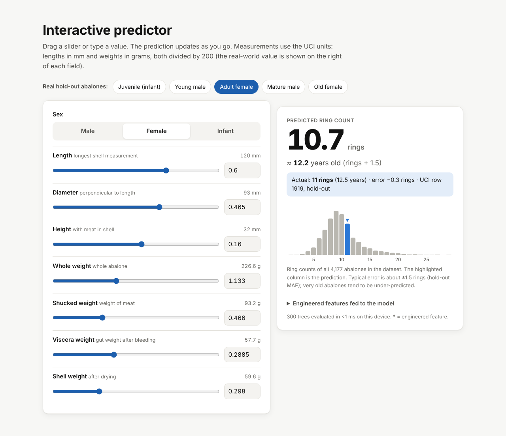
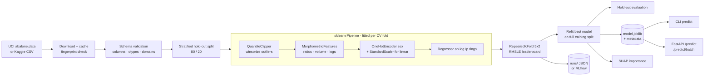

# Abalone Age Regression Pipeline

[](https://github.com/srini2k03/abalone-age-regression/actions/workflows/ci.yml)
[](https://srini2k03.github.io/abalone-age-regression/)


[](https://github.com/astral-sh/ruff)
[](LICENSE)

Predict the **age of an abalone** (number of shell rings; age ≈ rings + 1.5 years) from cheap
morphometric measurements (length, diameter, height and four weights), instead of the slow
lab procedure of cutting the shell, staining it and counting rings under a microscope.

**[Live demo](https://srini2k03.github.io/abalone-age-regression/)**: try the tuned model in your
browser. It runs fully client-side, with no backend.

The project is a complete, reproducible ML pipeline: data download with integrity checks,
schema validation, scikit-learn feature transformers, a model zoo trained directly for
**RMSLE**, repeated K-fold model comparison, stacking/blending ensembles, Optuna tuning,
SHAP explanations, experiment tracking, a CLI, a FastAPI service and a Docker image.

> Originally built (Feb 2024) for the Kaggle **Playground Series S4E4** abalone competition,
> whose data is synthetically generated from the public
> [UCI Abalone dataset](https://archive.ics.uci.edu/dataset/1/abalone). This repository runs on
> the UCI original by default and also accepts the Kaggle `train.csv` / `test.csv`.

---

## Highlights

- **Optimises the metric directly** — every model is wrapped in a
  `TransformedTargetRegressor(log1p / expm1)`, so minimising squared error in model space *is*
  minimising RMSLE in ring space.
- **Leak-free feature engineering** — outlier clipping bounds, scalers and encoders are learned
  inside each CV fold as part of one sklearn `Pipeline`.
- **Systematic comparison** — `RepeatedKFold` (5 folds × 2 repeats) over a mean baseline, Linear,
  Ridge, Random Forest, XGBoost, LightGBM, CatBoost, a stacked ensemble and a blended ensemble.
- **Reproducible data** — UCI download with mirror fallback, local caching, file SHA-256 of the
  cache and a line-ending-independent *content fingerprint* of the 4,177-row table.
- **Production surface** — `abalone train | evaluate | tune | predict | explain` CLI, joblib model
  bundles with metadata, FastAPI (single + batch endpoints), Dockerfile, CI.

## Live demo

**https://srini2k03.github.io/abalone-age-regression/**

[](https://srini2k03.github.io/abalone-age-regression/)

A static single-page site (`web/`, plain HTML/CSS/JS, no build step) that makes real predictions
in the browser:

- **Model:** the tuned XGBoost pipeline from the *Tuning* result below (300 trees, depth 4),
  fitted on the 3,341-row training split with the project's own features. Hold-out RMSLE
  **0.1656** on the 836 unseen rows; 5×2 CV RMSLE 0.1681 ± 0.0038. The trees and the
  `QuantileClipper` bounds are exported to `web/data/model.json` (~190 kB).
- **Feature engineering in JS:** [`web/js/model.js`](web/js/model.js) ports clipping, the
  morphometric features and the one-hot encoding line by line, then walks the trees with float32
  thresholds and accumulation as XGBoost does.
- **Parity check:** on 196 rows (random rows, every anomalous UCI row and out-of-range inputs) the
  JS output matches Python with a max absolute difference of 6.7e-7 rings (the log-space margins
  are identical). The Pages workflow re-runs this check before deploying.
- **Page:** live predictor with sliders and presets taken from real hold-out rows, the CV
  comparison chart and table above, real SHAP importances for the deployed model, and a pipeline
  diagram. Light and dark themes, responsive down to phone width.

```bash
python scripts/export_web_model.py     # retrain + export web/data/*.json, then run the parity check
node scripts/check_web_parity.mjs      # parity check only
node scripts/web_smoke_test.cjs        # headless-Chromium test of the page (needs `playwright`)
python -m http.server -d web 8000      # preview at http://localhost:8000
```

Deployment: [`.github/workflows/pages.yml`](.github/workflows/pages.yml) publishes `web/` to the
`gh-pages` branch on every push to `main`. In *Settings → Pages*, the source must be set to
*Deploy from a branch: `gh-pages` / root*.

## Pipeline



## Feature engineering

All features are produced by scikit-learn transformers in
[`src/abalone/features.py`](src/abalone/features.py) and are toggled from the YAML config.

| Feature | Definition | Why |
|---|---|---|
| `sex_M`, `sex_F`, `sex_I` | One-hot of `sex` (unknown codes → all zeros) | Infants are systematically younger |
| `shucked_ratio`, `viscera_ratio`, `shell_ratio` | sub-weight / whole weight | Body composition shifts with age (shell share grows) |
| `meat_to_shell` | shucked weight / shell weight | Growth of meat vs. shell mineralisation |
| `volume` | length × diameter × height | Size proxy (approx. ellipsoid volume) |
| `density` | whole weight / volume | Older shells are denser |
| `aspect_ratio` | diameter / length | Shell shape |
| `log_*_weight` | `log1p` of each weight column | Weights grow ~cubically with size; logs linearise them |
| Outlier handling | `QuantileClipper` winsorizes numeric inputs at the 0.1% / 99.9% quantiles of the training fold | Real data contains zero heights and sub-weights larger than the whole weight |
| Target | `log1p(rings)` (inverse `expm1` at predict time) | Squared error on log target == RMSLE |

Validation ([`validation.py`](src/abalone/validation.py)) rejects hard schema violations (missing
columns, NaNs, negative values, unknown sex codes) and counts soft anomalies. On UCI it reports
2 zero-height rows, 4 rows with shucked > whole weight and 1 with shell > whole weight.

## Results

**Dataset:** UCI Abalone, 4,177 rows (content fingerprint
`55eb3299…c9cc3c1f`, see `configs/default.yaml`; for the run below the file was served by the
GitHub mirror listed in the config because the UCI host was unreachable from the build machine). 80/20 split stratified on rings →
3,341 training rows for cross-validation, 836 hold-out rows never seen during model selection.
**CV:** `RepeatedKFold(n_splits=5, n_repeats=2, random_state=42)`, default hyperparameters from
`configs/default.yaml` (no tuning). Produced by `abalone train` on a 4-core CPU (~4 minutes).

| Model | CV RMSLE (mean ± std) | CV RMSE (rings) | CV MAE | CV R² | vs. mean baseline |
|---|---|---|---|---|---|
| **Blend** (mean of Ridge, RF, XGB, LGBM, CatBoost) | **0.1678 ± 0.0040** | 2.082 | 1.449 | 0.582 | −41.5% |
| Stacking (non-negative linear meta-learner) | 0.1682 ± 0.0037 | 2.079 | 1.447 | 0.583 | −41.4% |
| Random Forest | 0.1693 ± 0.0045 | 2.101 | 1.462 | 0.574 | −41.0% |
| CatBoost | 0.1699 ± 0.0041 | 2.106 | 1.468 | 0.572 | −40.8% |
| XGBoost | 0.1701 ± 0.0038 | 2.113 | 1.469 | 0.569 | −40.7% |
| LightGBM | 0.1717 ± 0.0042 | 2.129 | 1.482 | 0.562 | −40.2% |
| Linear Regression | 0.1729 ± 0.0030 | 2.120 | 1.486 | 0.566 | −39.7% |
| Ridge (α = 1) | 0.1765 ± 0.0060 | 2.139 | 1.500 | 0.559 | −38.5% |
| Baseline (mean of log1p rings) | 0.2869 ± 0.0090 | 3.253 | 2.364 | −0.021 | — |

**Hold-out (836 unseen rows), selected model = Blend:** RMSLE **0.1659**, RMSE 2.09 rings,
MAE 1.48 rings, R² 0.579 — a **41.6%** RMSLE reduction over the mean baseline (0.2839) and about
3% better than plain linear regression in CV.

**Tuning:** a short 10-trial Optuna search for XGBoost (`abalone tune --n-trials 10`) brought
XGBoost alone from 0.1701 to **0.1681 ± 0.0038** CV RMSLE (same 5×2 protocol, via
`abalone train -m baseline,xgboost --params models/best_params.json`), on par with the ensembles.

**SHAP** (XGBoost member of the blend, mean |SHAP| in log-rings space): `shell_weight` and
`shucked_ratio` dominate, followed by `log_shell_weight`, `volume`, `height` and
`meat_to_shell` — the engineered composition ratios carry as much signal as the raw weights.

> **About the resume figure.** The original Feb 2024 submission on the Kaggle Playground S4E4
> data reported an RMSLE of **0.21** on that competition's test set, an 18% improvement over the
> author's baseline (author's reported result). That number is *not* reproduced here: the Kaggle
> data is synthetic, larger and has a different noise profile, and it is not redistributed in
> this repository. To score the Kaggle data, download it and run
> `abalone train -d data/kaggle/train.csv` (see below).

Numbers are reproducible with `make train`; each run writes a full leaderboard, parameters and
metrics to `runs/<timestamp>_train_<id>/`.

## Quick start

```bash
git clone https://github.com/srini2k03/abalone-age-regression.git
cd abalone-age-regression
make install            # python -m venv .venv && pip install -e ".[all]"
source .venv/bin/activate

abalone train           # downloads + caches UCI data, CV leaderboard, saves models/model.joblib
abalone evaluate        # re-score the saved model on the hold-out split
abalone explain         # SHAP table + plot -> reports/
```

Minimal install (core models only): `pip install -e .`; extras: `[lightgbm]`, `[tune]`,
`[explain]`, `[api]`, `[mlflow]`, `[dev]`, `[all]`.

### CLI reference

```bash
# Quick run: one CV repeat, a subset of models
abalone train --n-repeats 1 --models baseline,linear,xgboost,catboost

# Force the final model, custom config and output path
abalone train -c configs/default.yaml --select catboost -o models/catboost.joblib

# Hyperparameter search (Optuna TPE) then train with the result
abalone tune --model xgboost --n-trials 50 -o models/best_params.json
abalone train --params models/best_params.json

# Batch predictions (CSV with UCI or Kaggle headers, or a raw .data file)
abalone predict new_abalones.csv -o predictions.csv

# Kaggle Playground S4E4
abalone train -d data/kaggle/train.csv
abalone predict data/kaggle/test.csv --kaggle -o submission.csv   # id,Rings
```

Model names: `baseline, linear, ridge, random_forest, xgboost, lightgbm, catboost, stacking, blend`.
Models whose optional dependency is missing are skipped with a warning.

### Configuration

Everything is driven by [`configs/default.yaml`](configs/default.yaml) and validated with pydantic:
data source and mirrors, expected fingerprint, hold-out size, feature toggles and clip
quantiles, CV folds/repeats, enabled models and their hyperparameters, ensemble members,
tracking backend (`json` or `mlflow`) and artifact paths.

## Inference API

```bash
make serve                       # uvicorn on :8000 using models/model.joblib
# or with Docker (mount a trained bundle)
make docker-build && make docker-run
```

Interactive docs at `http://localhost:8000/docs`.

| Method | Path | Description |
|---|---|---|
| GET | `/health` | Liveness + whether a model is loaded |
| GET | `/model/info` | Model name, CV and hold-out metrics from the bundle metadata |
| POST | `/predict` | One abalone → rings and age |
| POST | `/predict/batch` | Up to 10,000 abalones in one request |

```bash
curl -s -X POST localhost:8000/predict -H 'content-type: application/json' -d '{
  "sex": "M", "length": 0.455, "diameter": 0.365, "height": 0.095,
  "whole_weight": 0.514, "shucked_weight": 0.2245, "viscera_weight": 0.101, "shell_weight": 0.15
}'
# {"predicted_rings":9.66,"predicted_age_years":11.16}

curl -s -X POST localhost:8000/predict/batch -H 'content-type: application/json' \
  -d '{"instances": [{"sex":"I","length":0.33,"diameter":0.255,"height":0.08,"whole_weight":0.205,
                      "shucked_weight":0.0895,"viscera_weight":0.0395,"shell_weight":0.055}]}'
```

Requests are validated by pydantic (`sex ∈ {M, F, I}`, positive bounded measurements); invalid
payloads return `422`, and `503` is returned if no model bundle is loaded.

## Project structure

```
abalone-age-regression/
├── configs/default.yaml          # experiment configuration
├── src/abalone/
│   ├── config.py                 # pydantic config models + YAML loader
│   ├── data.py                   # UCI download/cache/fingerprint, Kaggle CSV loading, splits
│   ├── validation.py             # schema checks + anomaly report
│   ├── features.py               # QuantileClipper, MorphometricFeatures, preprocessor
│   ├── metrics.py                # RMSLE + sklearn scorers
│   ├── models.py                 # model zoo, log1p target wrapper, stacking / blending
│   ├── evaluation.py             # repeated K-fold CV + leaderboard
│   ├── tuning.py                 # Optuna search spaces
│   ├── explain.py                # SHAP importance + plot
│   ├── tracking.py               # JSON / MLflow run tracking
│   ├── persistence.py            # joblib bundles with metadata
│   ├── pipeline.py               # train / evaluate / predict orchestration
│   ├── cli.py                    # `abalone` typer CLI
│   └── api/                      # FastAPI app + pydantic schemas
├── tests/                        # pytest suite (synthetic data, no network)
├── web/                          # static demo site (GitHub Pages): HTML/CSS/JS + exported model
├── scripts/                      # export_web_model.py, JS parity check, browser smoke test
├── notebooks/01_eda.ipynb        # exploratory analysis (outputs cleared)
├── .github/workflows/ci.yml      # ruff + pytest matrix + real-data smoke run + docker build
├── .github/workflows/pages.yml   # parity check + publish web/ to gh-pages
├── Dockerfile · Makefile · pyproject.toml · requirements*.txt
└── LICENSE
```

## Development

```bash
make lint      # ruff check + format check
make test      # 56 tests, ~10 s, no network required
make cov       # coverage report (~90%)
```

## Dataset

Nash, W., Sellers, T., Talbot, S., Cawthorn, A. & Ford, W. (1994). *Abalone* [Dataset].
UCI Machine Learning Repository. https://doi.org/10.24432/C55C7W — licensed CC BY 4.0.

The loader tries the UCI URL first and falls back to a public GitHub mirror of the same file;
whichever source is used must match the pinned content fingerprint.

## License

[MIT](LICENSE) © Srinivasan Balasubramanian
